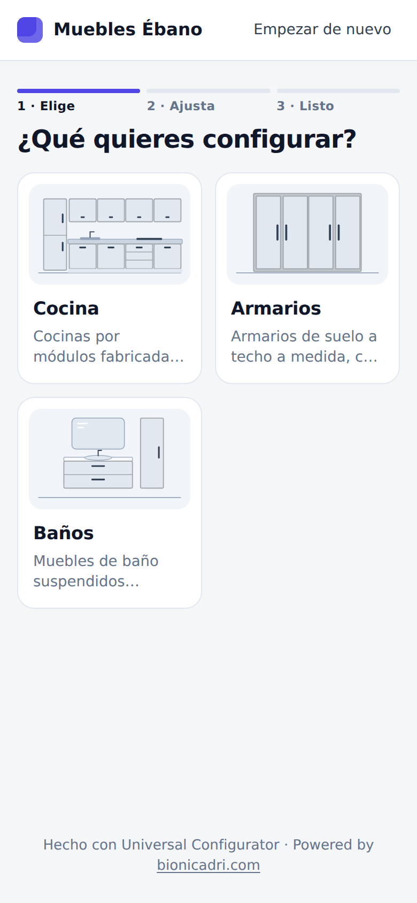
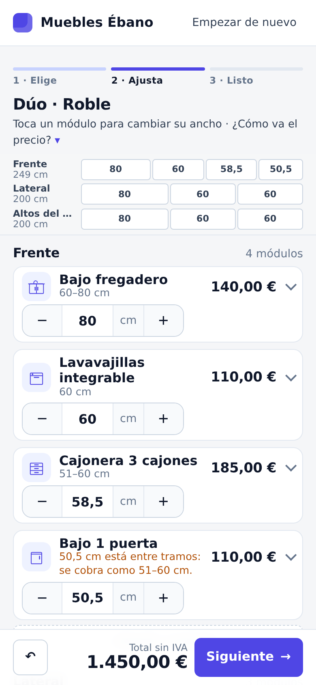
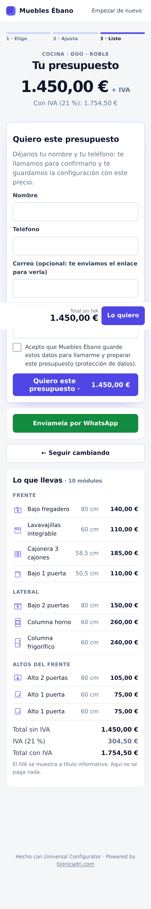
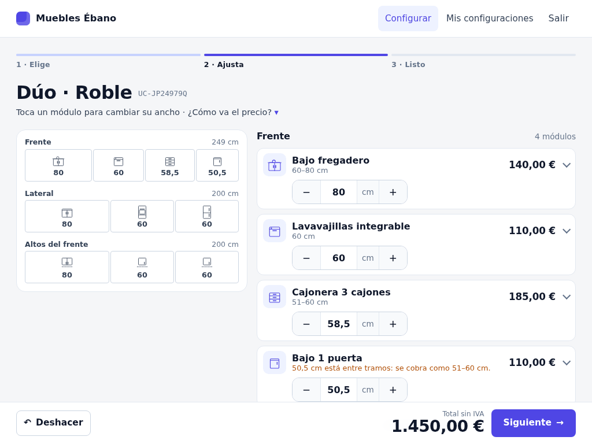
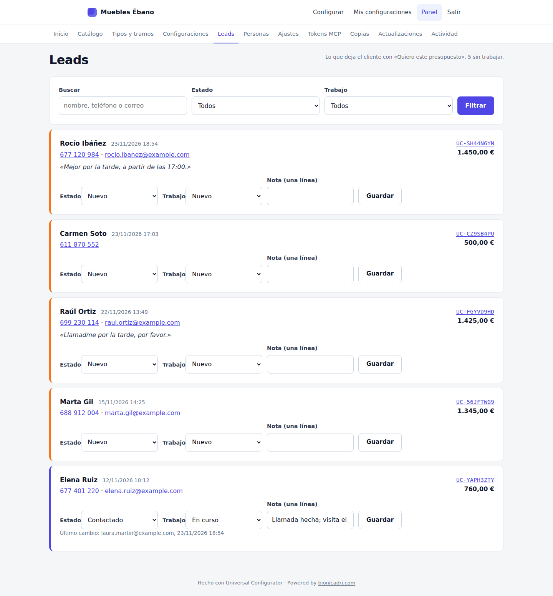
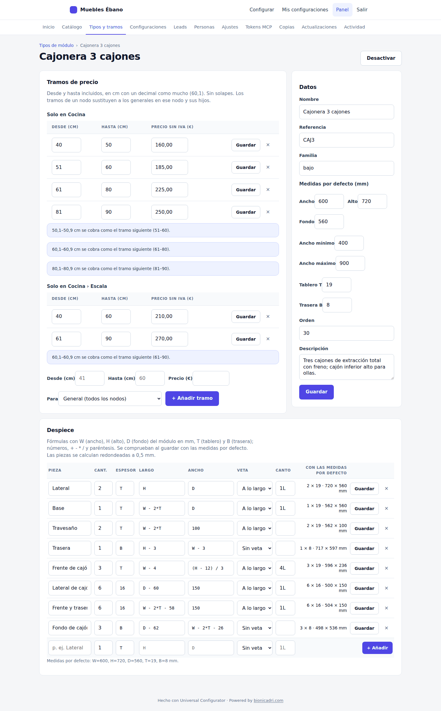
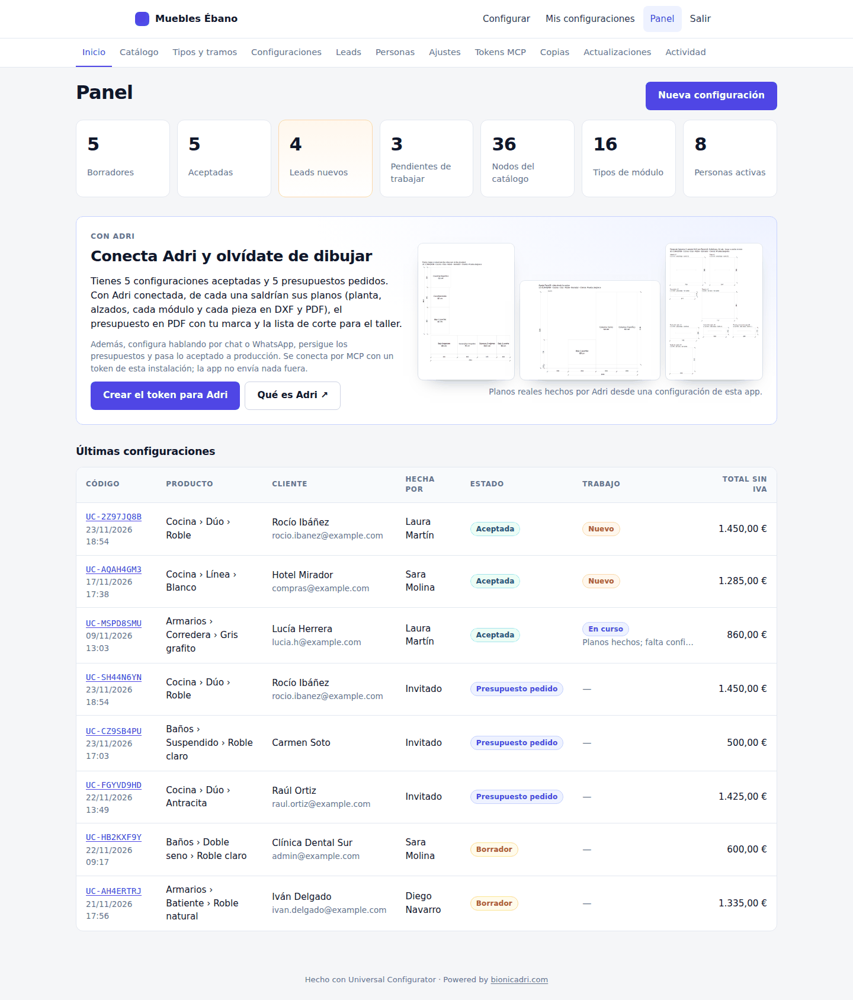

# Universal Configurator

Configurador de productos por catálogo para fabricantes y tiendas (cocinas, muebles, armarios…), con el precio al
momento. PHP puro, sin frameworks, sin Composer, sin Node; SQLite; panel propio; servidor MCP propio. Hermano de
Universal Web.

- El **administrador** carga un catálogo en árbol (p. ej. Cocina → Modelo → Color), los **tipos de módulo** con su
  **tabla de precios por tramos de medida** (de 41 a 60 cm = X €; no se cobra por centímetro) y la **composición por
  defecto** de cada modelo (paredes con sus módulos). Cada tipo lleva sus **medidas reales** (ancho, alto, fondo,
  tablero y trasera) y su **despiece por fórmulas** (laterales, base, trasera, puertas, cajones…).
- El **cliente final**, en su móvil y sin registrarse, elige con imágenes grandes, ajusta cada módulo con un dedo
  (admite un decimal: 58,5 cm) viendo el esquema de su cocina y el precio, deshace si se equivoca y, al final, pide el
  presupuesto («Quiero este presupuesto»: deja su teléfono y se crea un **lead**) o se la manda por **WhatsApp**.
- El **comercial**, con la tablet delante del cliente, configura igual y **acepta**: el precio queda **congelado**
  (si luego cambia la tarifa, lo aceptado no cambia).
- El administrador ve todas las configuraciones y los **leads** con su estado de trabajo, las descarga en **JSON** y
  **CSV**, hace **copias de seguridad** y **actualiza** la aplicación desde el panel.
- **ADRI** (u otra IA) se conecta por **MCP** y lee o cambia configuraciones con sus medidas exactas para hacer fuera lo
  pesado: plano CAD acotado del módulo y de sus piezas (medidas en mm y despiece), PDF profesional, seguimiento. La
  aplicación no dibuja planos. Manual del MCP para la IA: [`docs/MCP.md`](docs/MCP.md).

**Manual de uso** (cliente, comercial y administrador): [`docs/MANUAL.md`](docs/MANUAL.md). Qué se vende y a quién:
[`docs/PRODUCTO.md`](docs/PRODUCTO.md). El diseño completo (datos, reglas, acceso, pantallas, MCP) está en
[`docs/DISENO.md`](docs/DISENO.md). Cambios por versión: [`docs/CHANGELOG.md`](docs/CHANGELOG.md).

## Cómo se ve

| El cliente, en su móvil: elegir | Ajustar con el esquema de la cocina | Pedir el presupuesto |
|---|---|---|
|  |  |  |

| El comercial, en la tablet | El panel: leads y estado de trabajo |
|---|---|
|  |  |

| Tramos y despiece por fórmulas | Conecta Adri |
|---|---|
|  |  |

Todas las pantallas, comentadas: [`docs/CAPTURAS.md`](docs/CAPTURAS.md).

## Requisitos

- PHP 8.2 o superior con `pdo_sqlite`, `mbstring`, `sodium` y `json`.
- Un servidor web que sirva **solo la carpeta `public/`** (Caddy, Nginx o Apache; ejemplos en `deploy/`).
- La carpeta `data/` escribible por el usuario de PHP (ahí van la base de datos y `config.php`; nunca se sirve).

## Instalación

**En un VPS Ubuntu/Debian** (instala PHP-FPM y Caddy con HTTPS automático):

```bash
sudo ./install.sh --domain=configurador.miempresa.com --email=yo@miempresa.com --empresa="Mi empresa" --sample
```

**En cualquier servidor con PHP**: copia la carpeta, apunta el dominio a `public/` (ver `deploy/nginx.example`,
`deploy/apache.example` o `deploy/caddy.example`) y abre la dirección en el navegador: el instalador comprueba los
requisitos y crea `data/config.php`, la base de datos y la cuenta de administración. Para que solo instale quien tiene
acceso al servidor, pide un **código de un solo uso** que deja en `data/install-code.txt` (`cat data/install-code.txt`). Marca «Cargar datos de ejemplo»
para empezar con tres familias de ejemplo —cocinas (recta, en L y paralela), armarios (corredera y batiente) y baños
(mueble de lavabo suspendido y columna)— con sus acabados, 16 tipos de módulo con medidas reales, tramos, despiece e
ilustraciones; también se cargan después desde **Panel → Ajustes**.

**Desde la línea de órdenes** (como el usuario de PHP):

```bash
UC_PASSWORD='…' php bin/uc install --empresa="Mi empresa" --email=yo@miempresa.com --url=https://configurador.miempresa.com --sample
php bin/uc token --name=ADRI --email=yo@miempresa.com --scopes=read,write   # token MCP (se muestra una vez)
php bin/uc reset-link --email=persona@miempresa.com                          # enlace para poner contraseña
php bin/uc demo                                                               # SOLO para enseñar la app: ver abajo
php bin/uc backup                     # copia de seguridad ahora (con --auto, solo si toca: para cron)
php bin/uc restore <copia.zip> --yes  # restaurar (antes guarda otra del estado actual)
php bin/uc update:check               # ¿hay versión nueva? (la única conexión de salida, y solo si se pide)
php bin/uc update --yes               # actualizar (copia previa, firma y sha256, vuelta atrás si falla)
```

`bin/uc demo` carga una **demostración**: los datos de ejemplo, 3 comerciales y 4 clientes ficticios (`@example.com`,
contraseña común `demo-2026-clave`) y 12 configuraciones de las tres familias (aceptadas, en borrador y una anulada).
Nunca se ejecuta sola y se niega si ya está cargada. No la uses en una instalación real.

**Para desarrollar**: `php -S 127.0.0.1:8190 -t public public/index.php`.

La **URL pública** es obligatoria al instalar (el instalador web propone la dirección actual para que la confirmes):
es la única base de los enlaces que salen por correo y de la vuelta de BionicEye. Nunca se toma de la cabecera `Host`
de la petición; si falta, no se envía ningún enlace y el panel avisa.

Después de instalar, en **Panel → Ajustes**: dirección pública, IVA (solo se
muestra aparte), registro libre de clientes, configurar sin cuenta (invitado), y el correo (`mail()`, SMTP o «solo
registrar» en `data/mail.log` para pruebas). En **Panel → Personas** se dan de alta los comerciales: les llega el
enlace para poner su contraseña (y el panel lo enseña por si el correo no sale).

## Conectar ADRI por MCP

1. **Panel → Tokens MCP → Nuevo token**: ponle un nombre (p. ej. «ADRI»), elige **como quién actúa** y los permisos.
   - `read`: leer catálogo, configuraciones y leads. `write`: además crear, cambiar, aceptar, compartir y marcar el
     trabajo. Aceptar solo con un token de un comercial o un administrador.
   - El token actúa como la persona elegida: si es un comercial, solo ve y toca **sus** configuraciones; si es un
     administrador, todas. Si esa persona se desactiva, el token deja de valer.
   - El token se muestra **una sola vez**; se guarda solo su huella. Se revoca desde la misma pantalla.
2. En ADRI (o cualquier cliente MCP) añade el servidor:
   - Dirección: `https://configurador.miempresa.com/mcp` (JSON-RPC 2.0 por POST, sin estado).
   - Cabecera: `Authorization: Bearer uc_…`
3. Herramientas:

| Herramienta | Permiso | Qué hace |
|---|---|---|
| `catalog_tree` | read | Árbol de nodos activos (id, nombre, hijos, si es final) |
| `module_types` | read | Tipos con su fondo y sus tramos (generales y por nodo; con `node_id`, los que valen ahí) |
| `config_list` | read | Configuraciones con filtros (estado, desde, hasta, texto), paginadas |
| `config_get` | read | Una configuración entera: nodo, cliente, paredes con geometría (mm), módulos (cm), tramo y precio por línea, total |
| `price_check` | read | Precio de una lista de módulos para un nodo, sin guardar (y qué medida no es válida) |
| `config_create` | write | Borrador desde un nodo final con su composición por defecto, con `customer` opcional (o `copy_of` para duplicar) |
| `config_update` | write | Cambios en un borrador: `set_width`, `remove`, `add`, `replace`, `customer` (todos o ninguno) |
| `config_accept` | write | Acepta un borrador y congela su precio y su despiece. La aceptación la debe confirmar la persona |
| `cut_list` | read | Lista de corte agregada (piezas iguales sumadas por espesor y medidas, con su módulo de origen) |
| `config_share` | write | Enlace de solo lectura para el cliente (30 días) y el de WhatsApp |
| `config_mark` | write | Estado de trabajo de una aceptada (nuevo, en curso, hecho) y una nota |
| `lead_list` · `lead_get` | read | Clientes que pidieron presupuesto, con su configuración y su estado |
| `lead_mark` | write | Estado de trabajo y estado comercial de un lead |

**Lo nuevo sin procesar**: `config_list(pendientes=true)` → por cada una, lo tuyo → `config_mark(hecho, nota)`; y
`lead_list(work_status="nuevo")` → `lead_get` → `lead_mark`.

Para dibujar en CAD: `config_get` (medidas en mm y despiece de cada módulo) o `cut_list`. El precio y las piezas los
calcula siempre la aplicación. Un parámetro que la herramienta no conoce es un error, nunca se ignora.

`initialize` devuelve las instrucciones con el flujo recomendado. Los errores dicen qué falló (con el valor recibido),
qué vale, un ejemplo de llamada y «No se ha hecho nada». Todo queda en **Panel → Actividad**.

Prueba rápida:

```bash
curl -s https://configurador.miempresa.com/mcp -H "Authorization: Bearer uc_…" -H 'Content-Type: application/json' \
  -d '{"jsonrpc":"2.0","id":1,"method":"tools/call","params":{"name":"catalog_tree","arguments":{}}}'
```

## Reglas de precio (resumen)

- Anchos en **cm con un decimal** (58,5), guardados en mm enteros. Cada tipo de módulo tiene tramos `[desde, hasta]`
  (ambos incluidos, bordes con un decimal) sin solapes. Un ancho fuera del mínimo/máximo del tipo no es válido.
- Una medida que no cae en ningún tramo **no es válida**: se rechaza diciendo qué tramos hay.
- Un nodo (p. ej. un modelo) puede tener tramos propios de un tipo: **sustituyen** a los generales en ese nodo y sus
  hijos (manda el antepasado más cercano que tenga tramos de ese tipo).
- Total = suma de módulos, en EUR **sin IVA**. El IVA se muestra aparte. El cálculo está en una sola función del
  servidor (`precio_configuracion()` en `app/pricing.php`); la tablet nunca calcula precios.
- Importes guardados en céntimos enteros; la API y el MCP los dan en euros con 2 decimales (y `*_cents` y `*_text`).
- Despiece: fórmulas con W, H, D (mm), T (tablero) y B (trasera), con un intérprete propio (sin `eval`); piezas en mm
  redondeadas a 0,5 mm. Al aceptar se congela también el despiece.

## Pruebas

Sin PHPUnit. Cada prueba usa su propia carpeta de datos temporal:

```bash
php tests/run.php          # todas (sale con código ≠ 0 si algo falla)
php tests/pricing.php      # una sola
```

`tests/http.php` levanta `php -S` y recorre la aplicación por HTTP (instalador, panel, tablet, API y MCP).

## Traducir

Los textos de las pantallas pasan por `t('frase en español')` y se traducen en un único fichero, `app/textos.php` (la frase en español es la clave). Quedan en claro, sin `t()`, las instrucciones y descripciones del MCP (van dirigidas a la IA) y las etiquetas de requisitos del instalador.

## Licencia

**Licencia BionicAdri 2.0** (ver [`LICENSE`](LICENSE)): uso libre y gratuito para tu propio negocio, también para que
tus clientes, comerciales y distribuidores configuren y acepten tus productos; sin reventa ni servicio a terceros; sin
garantía ni soporte. El crédito «Hecho con Universal Configurator · Powered by bionicadri.com» no se puede quitar.
