# Capturas

Todas las pantallas con la **demostración** cargada (`bin/uc demo`: tres familias, 3 comerciales, 4 clientes y 12
configuraciones ficticias). Tres tamaños: escritorio 1440×900, tablet 1024×768 y móvil 390×844. Los nombres, correos y
teléfonos son inventados (`@example.com`).

Se hacen con `tests/capturas.cjs` (ver «Cómo se rehacen» al final).

## El configurador

**Entrar.** La empresa pone su nombre y su logo; el pie con el crédito lo exige la licencia.

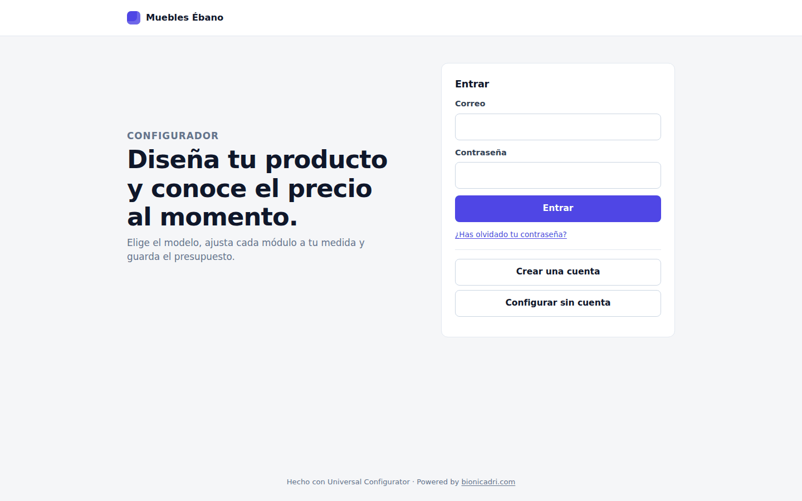

**Paso 1 — elegir.** Cada familia, modelo y acabado lleva una ilustración generada por la propia app (SVG sobrio, sin
fotos de internet) con el acabado como color. El administrador puede cambiarla por una imagen suya.

| Familias | Modelos de cocina | Acabados de un armario |
|---|---|---|
| 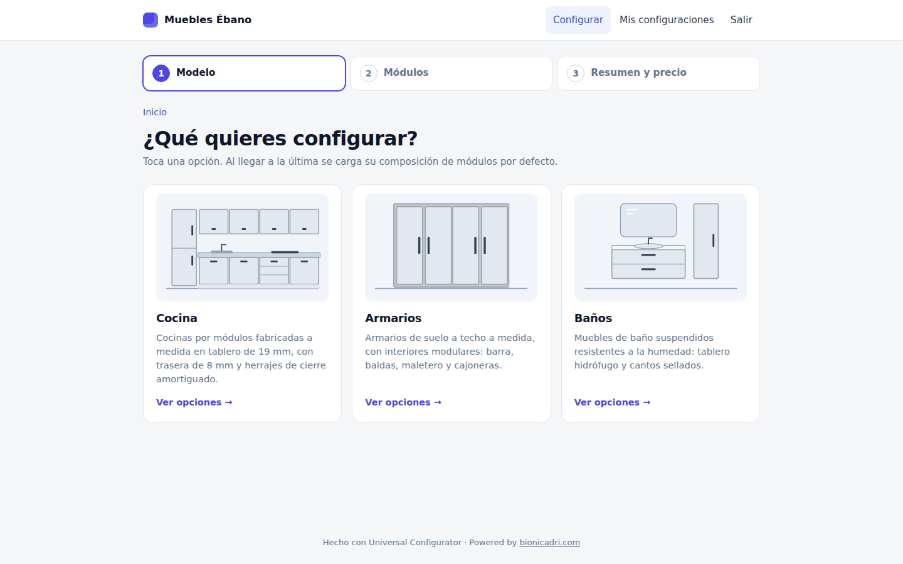 | 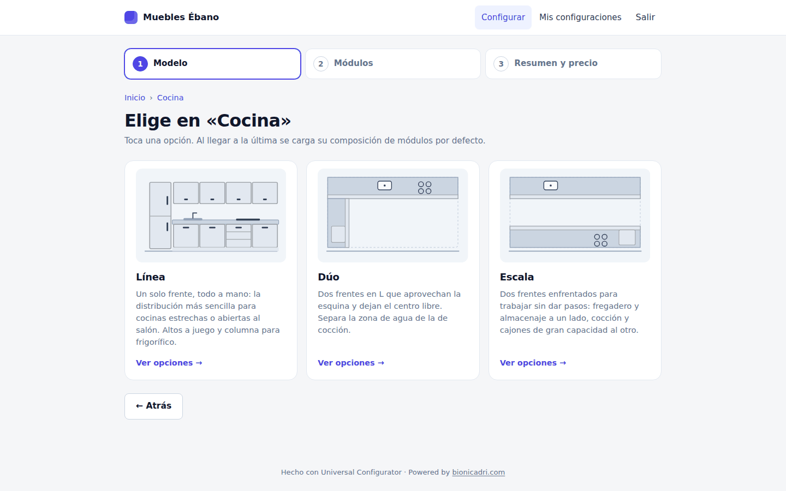 | 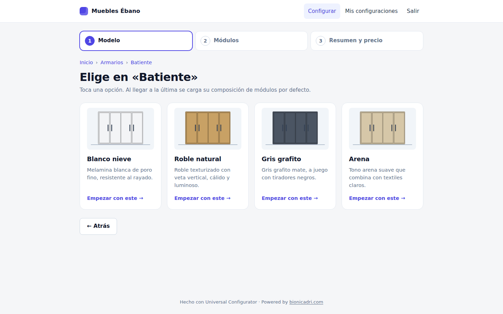 |

**Paso 2 — los módulos.** El ancho con − / + o escrito, con un decimal (58,5). Cada medida cae en un tramo con su
precio. Un ancho que queda entre dos tramos (50,5 cm, entre 41–50 y 51–60) se cobra como el tramo de arriba y la
tarjeta lo dice en llano.

| Escritorio | Tablet, en el módulo con el hueco de tramo |
|---|---|
| 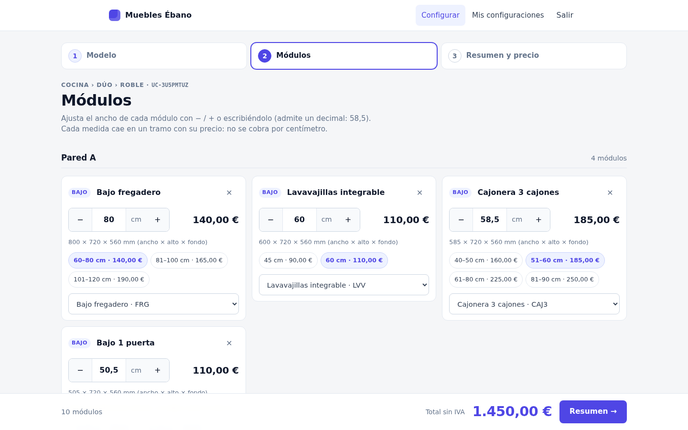 | 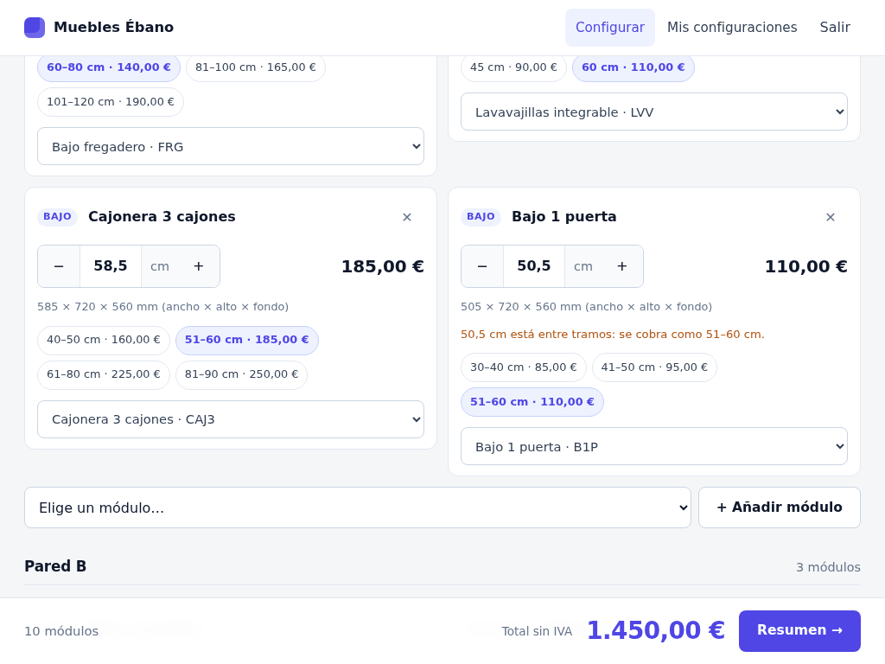 |

**Paso 3 — resumen y aceptar.** Al aceptar el precio se congela (aunque cambien las tarifas). «Mis configuraciones» es
la lista de cada persona.

| Resumen | Aceptada | Mis configuraciones |
|---|---|---|
| 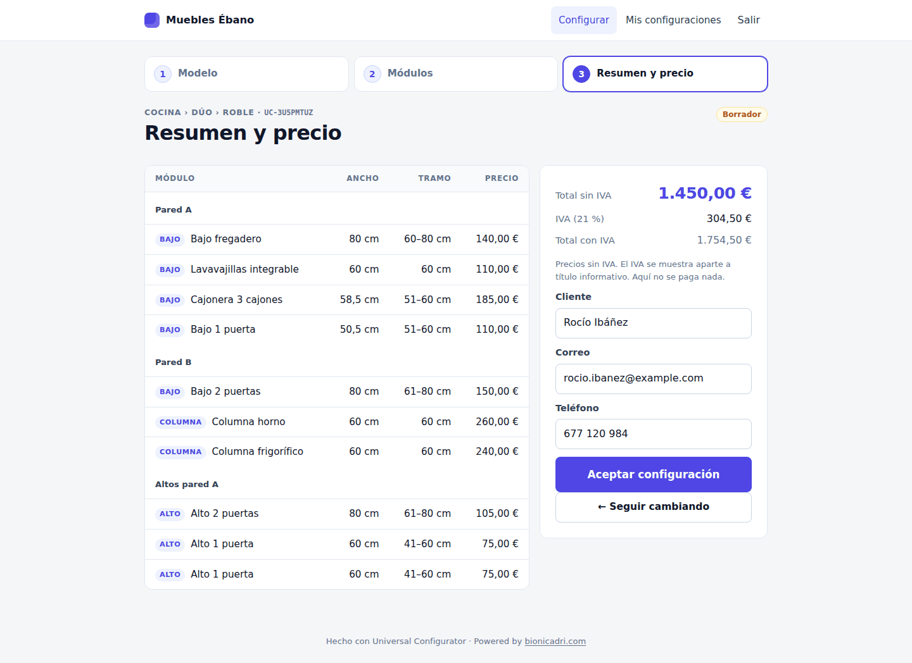 | 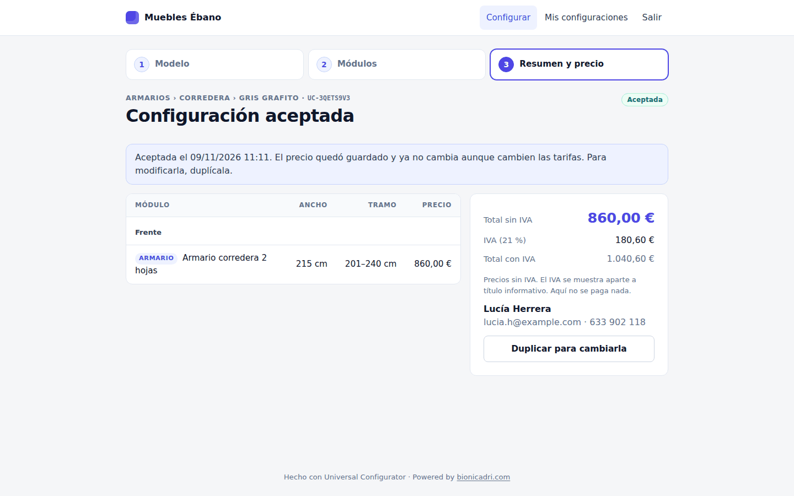 | 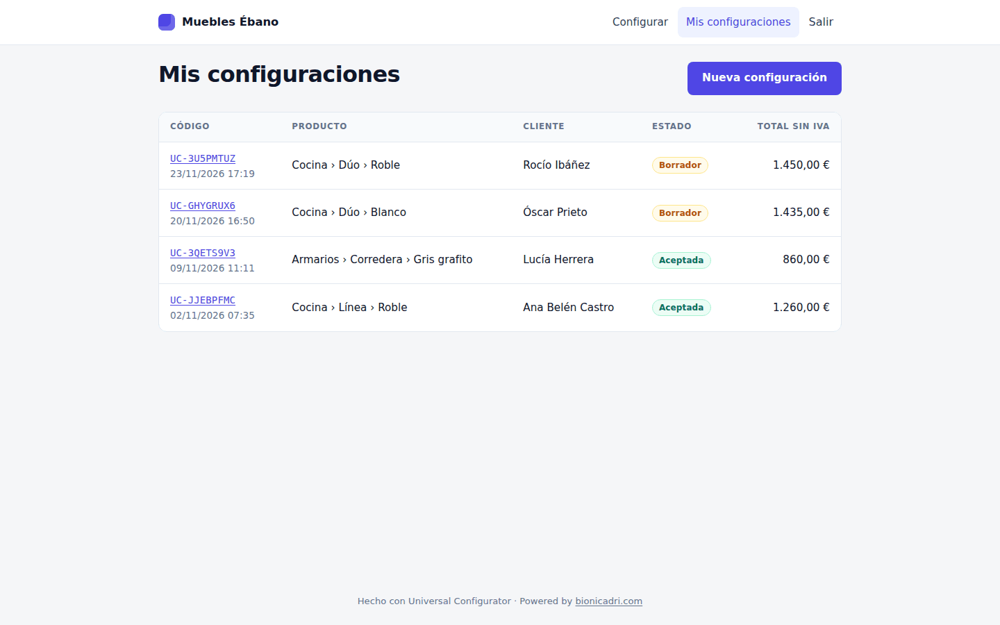 |

En el móvil: [entrar](capturas/entrar-movil.png) · [paso 1](capturas/paso1-familias-movil.png) ·
[paso 2](capturas/paso2-modulos-movil.png) · [hueco de tramo](capturas/paso2-hueco-de-tramo-movil.png) ·
[resumen](capturas/paso3-resumen-movil.png). En la tablet: [paso 1](capturas/paso1-familias-tablet.png) ·
[paso 2](capturas/paso2-modulos-tablet.png) · [resumen](capturas/paso3-resumen-tablet.png).

## El panel del administrador

**Inicio**: recuento y últimas configuraciones de todo el equipo.

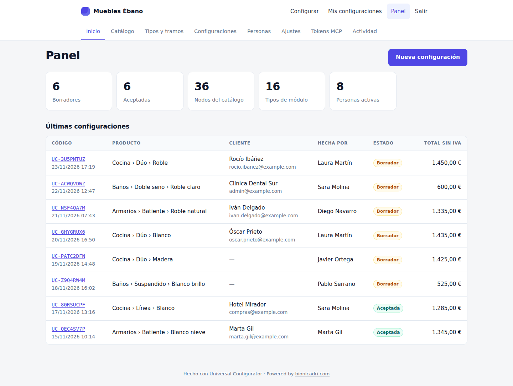

**Catálogo en árbol** (sin límite de niveles) y la ficha de un nodo: datos, ilustración o imagen subida (PNG, JPEG o
WebP, 2 MB como mucho), estado, hijos.

| Catálogo | Un nodo |
|---|---|
| 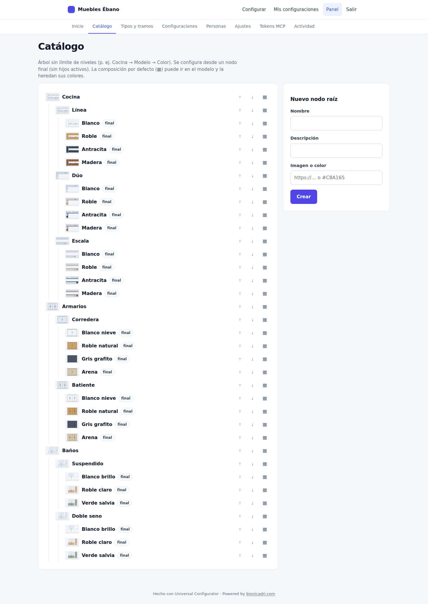 | 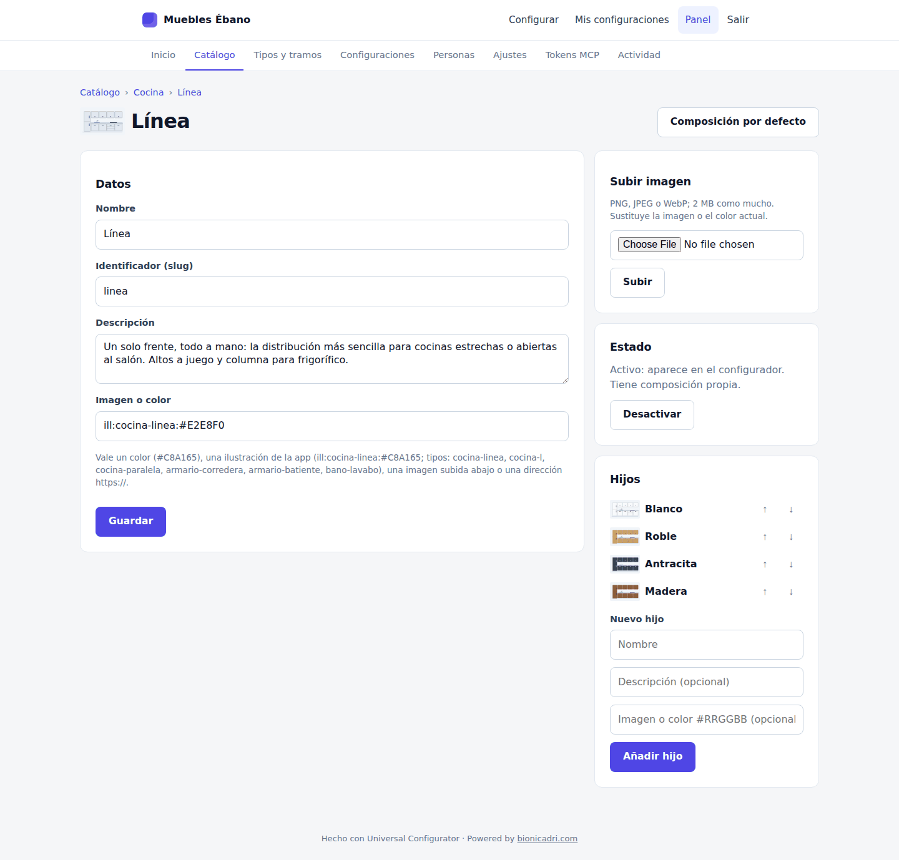 |

**Tipos de módulo y tramos.** Cada tipo con sus medidas, sus tramos por familia (y los que sustituyen en un modelo
concreto: la cajonera de «Escala» es de gama alta) y el aviso de los huecos que se cobran con el tramo de arriba.
Debajo, el **despiece por fórmulas** (W, H, D, T, B) con el resultado al momento para las medidas por defecto.

| Tipos | Cajonera: tramos y despiece | Armario corredera: hojas solapadas |
|---|---|---|
|  | 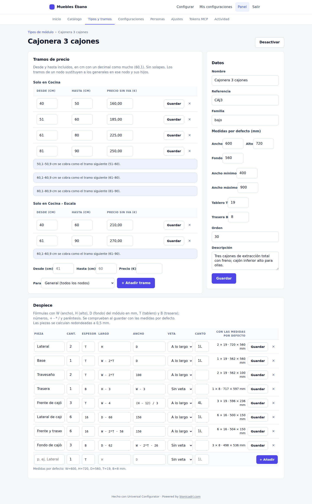 |  |

**Composición por defecto** del modelo «Dúo» (cocina en L): las paredes con su dirección y origen y los módulos con los
que arranca una configuración. Solo ofrece los módulos de su familia.


**Configuraciones** (filtros por texto, estado, fechas y persona; CSV) y la **ficha**: módulos por pared, despiece de
cada módulo, lista de corte agrupada y descargas JSON/CSV.

| Lista | Ficha (escritorio) | Ficha (tablet) |
|---|---|---|
|  |  | 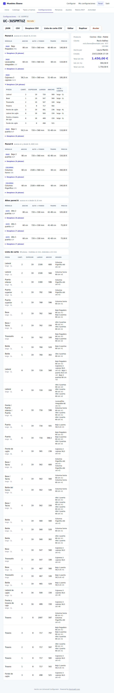 |

**Personas, ajustes, tokens MCP y actividad.** En los ajustes, el correo por SMTP con el botón de correo de prueba.
En tokens, el de la demostración ya está revocado: un token vivo solo se ve una vez, al crearlo, y nunca sale en una
captura.

| Personas | Ajustes | Tokens MCP | Actividad |
|---|---|---|---|
| 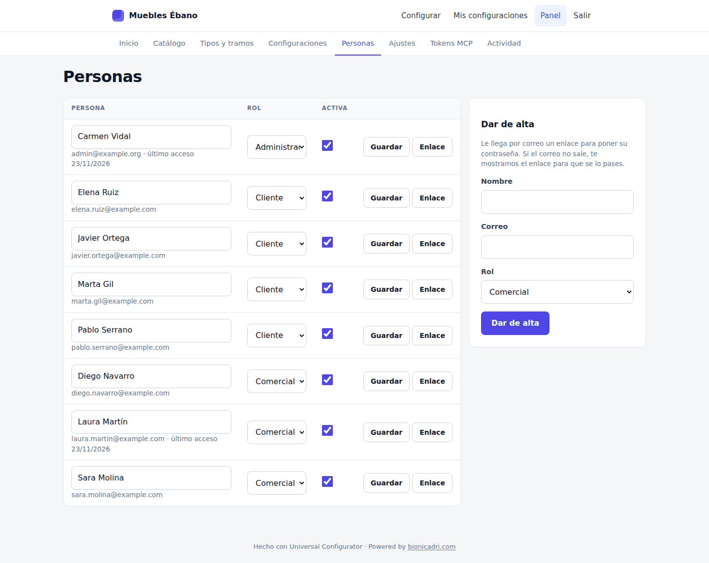 |  |  |  |

En el móvil: [inicio](capturas/panel-inicio-movil.png) · [catálogo](capturas/panel-catalogo-movil.png).

## Lo que se corrigió al mirarlas (v0.2)

- Los tiradores de los acabados oscuros (gris grafito, antracita) no se veían: el color del tirador sale ahora del
  contraste con el acabado.
- La cuadrícula de opciones dejaba una tarjeta suelta en una fila (4 acabados en 3 columnas): ahora se reparte sola.
- El despiece del tipo de módulo se salía por la derecha en escritorio (la última columna y los botones no se veían) y
  las fórmulas largas se cortaban: columnas más justas, «A lo largo / A lo ancho» en la columna «Veta» y el resultado
  en dos líneas.
- El tramo de un solo valor se leía «60–60 cm»: ahora «60 cm».
- La composición por defecto ofrecía los módulos de las tres familias (un armario en una cocina): ahora solo los que
  tienen tramos para ese modelo.
- En el móvil, el árbol del catálogo se salía de la pantalla y las tablas de configuraciones tapaban el estado: árbol
  más compacto, estado bajo el código y el correo del cliente oculto en pantallas pequeñas.
- La barra fija del total tapaba el módulo del hueco de tramo en la captura de página entera: el paso 2 se captura a
  tamaño de pantalla, centrado en ese módulo.

## Cómo se rehacen

```bash
docker run -d --name uc-dev -p 127.0.0.1:8190:8190 -e UC_DATA=/tmp/uc-data -v "$PWD":/app -w /app wordpress:cli-php8.2 \
  php -S 0.0.0.0:8190 -t public public/index.php
docker exec -e UC_DATA=/tmp/uc-data -e UC_PASSWORD=admin-12345 uc-dev sh -c 'php bin/uc install --empresa="Muebles Ébano" \
  --email=admin@example.org --name="Carmen Vidal" --url=http://127.0.0.1:8190 && php bin/uc demo && php -r "require \"app/bootstrap.php\";
  settings_save([\"permitir_registro\"=>\"1\",\"permitir_invitado\"=>\"1\",\"mail_transport\"=>\"smtp\",\"smtp_host\"=>\"smtp.muebles-ebano.example\",
  \"smtp_port\"=>\"587\",\"smtp_encryption\"=>\"tls\",\"mail_from\"=>\"pedidos@muebles-ebano.example\"]);"'
PW_CORE=/ruta/a/playwright-core CHROME=/ruta/a/chrome node tests/capturas.cjs /tmp/capturas
docker rm -f uc-dev
```

El script avisa si alguna página se sale por la derecha. Las elegidas se copian a `docs/capturas/` reducidas a paleta
de 256 colores (en capturas de interfaz no se nota y pesan un tercio).
