# Manual de Universal Configurator (v0.3)

Este manual explica cómo se usa la aplicación, para cada persona que la toca. Las imágenes son capturas reales de la
demostración (`bin/uc demo`): los nombres y teléfonos son inventados.

- [Qué es y para quién](#qué-es-y-para-quién)
- [Manual del cliente final](#manual-del-cliente-final) (1 página)
- [Manual del comercial](#manual-del-comercial)
- [Manual del administrador](#manual-del-administrador)
- [Preguntas frecuentes y problemas típicos](#preguntas-frecuentes-y-problemas-típicos)

---

## Qué es y para quién

Universal Configurator es una aplicación web para que un fabricante o una tienda de muebles a medida (cocinas,
armarios, baños…) enseñe **sus productos con precio al momento**. Se instala en tu propio servidor, es gratis y no
envía nada a nadie.

Tres personas la usan:

| Quién | Qué hace |
|---|---|
| **El cliente final** (tu cliente), en su móvil | Elige el modelo, ajusta las medidas, ve el precio y pide el presupuesto, sin registrarse |
| **El comercial**, con la tablet delante del cliente | Configura rápido, enseña el precio y **acepta** la venta |
| **El administrador** (el dueño o la oficina) | Prepara el catálogo y los precios, ve todo, atiende los leads, hace copias y actualiza |

Lo que hace la aplicación sola (gratis) y lo que añade **Adri**, la asistente de BionicAdri que se conecta por MCP
(planos CAD automáticos, presupuesto en PDF, lista de corte, seguimiento de los clientes…), está en la tabla de
[`PRODUCTO.md`](PRODUCTO.md#gratis-la-app-frente-a-con-adri-lo-que-se-vende).

---

## Manual del cliente final

> Para ponerlo en tu web o mandarlo por WhatsApp: «Configura tu cocina en 2 minutos y mira el precio».

**1. Empieza.** Abre la dirección del configurador y toca **Empezar**. No hace falta registrarse.

**2. Elige.** Toca la familia (cocina, armario, baño), luego el modelo y luego el acabado. Cada opción lleva su dibujo
con el color del acabado. Para volver, **Atrás**.

**3. Ajusta.** Ves arriba el **esquema** de tu cocina: una tira por pared con cada módulo y su ancho. Debajo, una
tarjeta por módulo con su precio.
- Cambia el ancho con **−** y **+** (de centímetro en centímetro) o tocando el número (admite un decimal: 58,5).
- **El precio va por tramos**: dentro de un tramo (por ejemplo de 51 a 60 cm) el precio no cambia. Si eliges una
  medida que cae entre dos tramos (50,5 cm, entre 41–50 y 51–60), se cobra como el tramo de arriba y la tarjeta te lo
  dice.
- Toca la tarjeta para ver más: los tramos como botones (toca uno y el módulo se pone a esa medida), **Cambiar por
  otro** (eliges el nuevo módulo de una lista con dibujos) y **Quitar**.
- ¿Te has equivocado? **Deshacer** (abajo a la izquierda) vuelve atrás el último cambio.
- El total, sin IVA, está siempre abajo. Cuando lo tengas, **Siguiente**.

**4. Listo.** Ves el total grande, sin IVA y con IVA, y lo que llevas. Tres opciones:
- **Quiero este presupuesto**: deja tu nombre y tu teléfono (y, si quieres, tu correo y un mensaje), marca la casilla
  de protección de datos y envía. Tu configuración queda guardada a tu nombre con ese precio y te llamarán. Si dejas el
  correo, te llega el enlace para verla cuando quieras.
- **Envíamela por WhatsApp**: te abre WhatsApp con el enlace de tu configuración para mandártela o mandarla a quien
  quieras. El enlace dura 30 días y no lleva tus datos.
- **Seguir cambiando**: vuelves a los módulos.

| Elige | Ajusta | Listo |
|---|---|---|
| 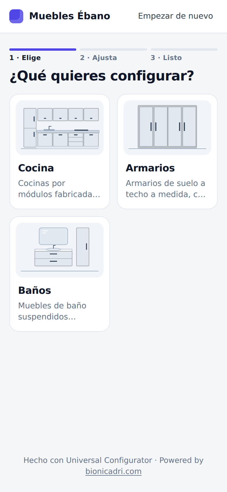 | 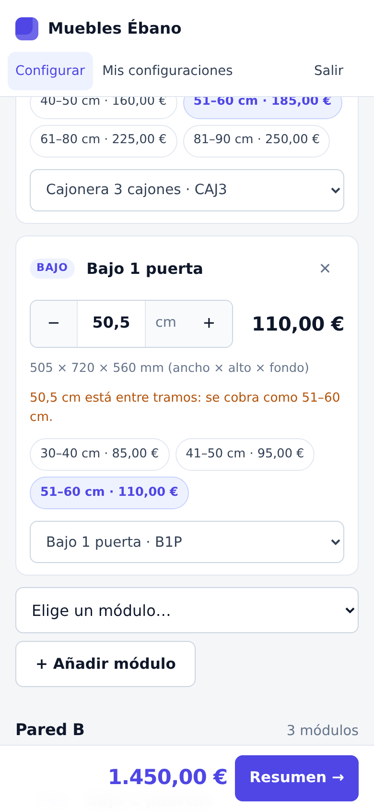 | 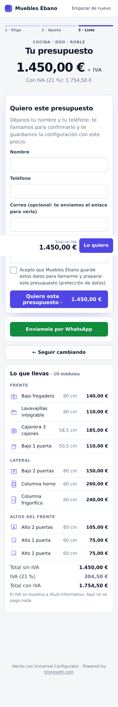 |

---

## Manual del comercial

Tu cuenta te la crea el administrador: te llega un correo con un enlace para poner tu contraseña (si no llega, el
administrador puede copiarte el enlace desde el panel). Entra en `/entrar`.

**Configurar en la visita.** **Configurar** → eliges como el cliente (familia, modelo, acabado). En la tablet ves el
esquema a la izquierda y las tarjetas a la derecha. Además de lo que ve el cliente, tú ves el **código** de la
configuración (UC-…) y la **referencia** de cada módulo. Puedes añadir módulos a cada pared con **Añadir módulo**.

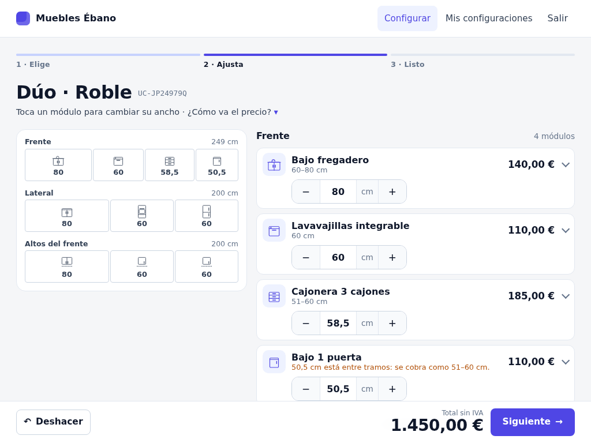

**Aceptar.** En **Siguiente** (el resumen) escribes los datos del cliente (nombre, correo, teléfono) y pulsas
**Aceptar configuración**. Al aceptar, el precio y el despiece quedan **guardados**: aunque luego cambien las tarifas,
esa configuración no cambia. Una aceptada ya no se edita; para cambiarla, **Duplicar** (sale una copia en borrador con
los precios de hoy). Aceptar es solo del equipo: el cliente, desde su móvil, pide el presupuesto.

**Si el cliente lo pidió desde casa.** Lo que el cliente pide con «Quiero este presupuesto» queda como **Presupuesto
pedido** con el precio que vio. Cuando cierres la venta, ábrela y pulsa **Aceptar (cerrar la venta)**: se mantiene ese
precio.

**Mis configuraciones.** La lista de las tuyas, con su estado y su total. Solo ves las tuyas.

**Compartir.** En el resumen, **Enlace para el cliente (WhatsApp)** te da el enlace de solo lectura para mandárselo.

| Resumen y aceptar | Aceptada | Mis configuraciones |
|---|---|---|
| 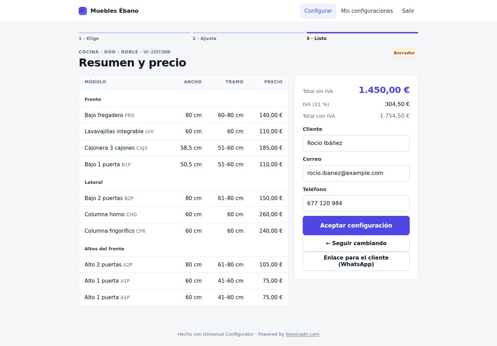 | 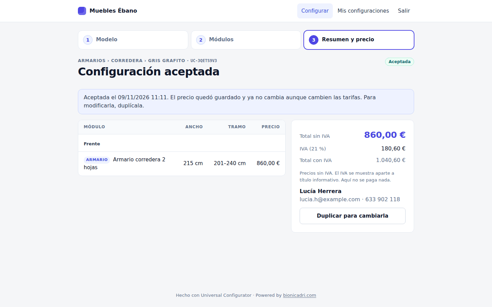 | 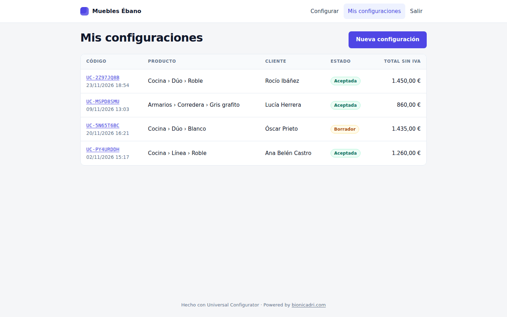 |

---

## Manual del administrador

### Instalar

En un VPS Ubuntu/Debian: `sudo ./install.sh --domain=configurador.miempresa.com --email=yo@miempresa.com --empresa="Mi
empresa" --sample` (instala PHP y Caddy con HTTPS). En un hosting: sube la carpeta, apunta el dominio a `public/` y
abre la dirección: el instalador web pide el código de instalación (está en `data/install-code.txt`), el nombre de
la empresa, tu correo, tu contraseña y la **dirección pública** (la de los enlaces de los correos). Con «datos de
ejemplo» empiezas con cocinas, armarios y baños ya montados. Detalle en el [README](../README.md#instalación).

Si el hosting no deja apuntar el dominio a `public/` y subes todo a la raíz, el `.htaccess` de la raíz protege `data/`,
`app/` y el resto, **pero solo si Apache lee los `.htaccess`** (`AllowOverride All`). Con `AllowOverride None` no lee
ninguno y `data/` (la base de datos y las copias) quedaría a la vista: en ese caso, apunta el dominio a `public/`.

### Catálogo en árbol

**Panel → Catálogo.** El catálogo es un árbol sin límite de niveles: familia → modelo → acabado (o lo que necesites).
Se configura desde un **nodo final** (uno sin hijos activos). En cada nodo: nombre, descripción, imagen, activar o
desactivar (un nodo desactivado no aparece, ni sus hijos), ordenar con ↑ ↓ y añadir hijos.

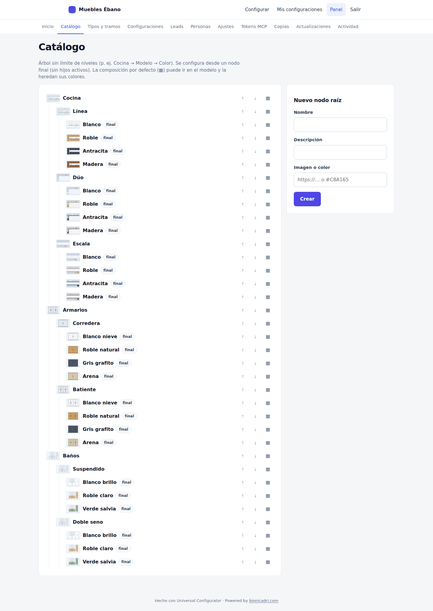

**Imágenes.** Cada nodo puede llevar:
- un **color** (`#C8A165`): una muestra redonda;
- una **ilustración** de la aplicación con el color del acabado (`ill:cocina-linea:#C8A165`; tipos: cocina-linea,
  cocina-l, cocina-paralela, armario-corredera, armario-batiente, bano-lavabo);
- una **imagen subida** (**Subir imagen**: PNG, JPEG o WebP de verdad, 2 MB como mucho; la aplicación la vuelve a
  guardar limpia y con un nombre aleatorio);
- o una dirección `https://…`.

### Tipos de módulo y tramos

**Panel → Tipos y tramos.** Cada tipo de módulo (bajo de 1 puerta, cajonera, columna…) tiene sus **medidas por
defecto** (ancho, alto, fondo en mm), el ancho mínimo y máximo, el espesor del tablero (T) y de la trasera (B).

Su **precio va por tramos de medida**: «de 41 a 60 cm, 190 €». Los dos bordes están incluidos y admiten un decimal
(60,1). Los tramos no se pueden solapar (el panel lo impide). Los tramos se ponen **para una familia** (por ejemplo
«Solo en Cocina»: así cada familia solo ofrece sus módulos) y un modelo puede tener los suyos, que **sustituyen** a los
de la familia en ese modelo (en la demo, la cajonera del modelo Escala es de gama alta).

**El hueco entre dos tramos se cobra con el tramo de arriba.** Con 41–50 y 51–60, una medida de 50,5 cm se cobra como
51–60. El panel lo explica debajo de los tramos («50,1–50,9 cm se cobra como el tramo siguiente») y al cliente se le
dice en la tarjeta. Lo que queda por debajo del primer tramo, por encima del último o fuera del mínimo/máximo del tipo
**no es válido**: la aplicación lo rechaza diciendo qué tramos hay.

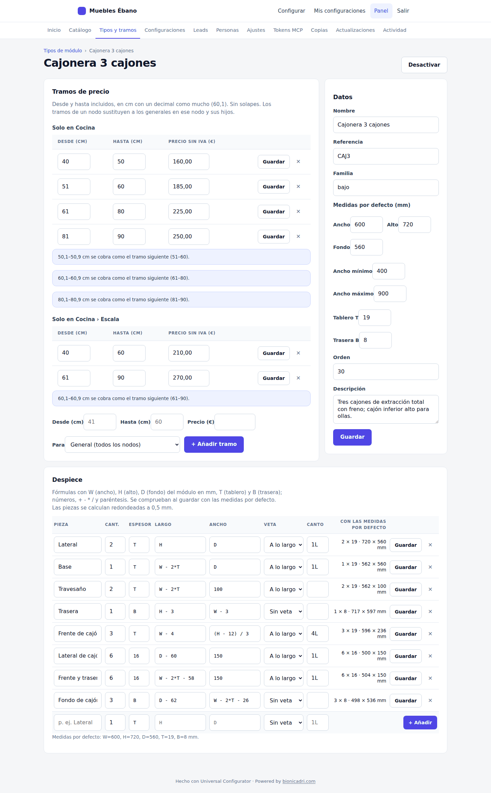

### Medidas y despiece por fórmulas

En el mismo tipo, el **Despiece**: cada pieza con su cantidad, espesor, largo, ancho, veta y canto. Las medidas son
**fórmulas** con:

| Letra | Qué es |
|---|---|
| **W** | ancho del módulo (mm), el que elige el cliente |
| **H** | alto del módulo (mm) |
| **D** | fondo del módulo (mm) |
| **T** | espesor del tablero (19 mm por defecto) |
| **B** | espesor de la trasera (8 mm por defecto) |

Se pueden usar números, `+ - * /` y paréntesis. A la derecha ves al momento cuánto da con las medidas por defecto.
Las piezas se redondean a 0,5 mm. Tres ejemplos:

1. **Base de un bajo: largo `W - 2*T`.** La base va entre los dos laterales, así que mide el ancho del módulo menos los
   dos tableros: con un módulo de 600 mm y tablero de 19, 600 − 38 = **562 mm**.
2. **Puerta de un módulo de dos puertas: ancho `(W - 7) / 2`.** Se quitan 7 mm de holguras (bordes y junta entre las
   dos puertas) y se reparte entre dos: con 800 mm, (800 − 7) / 2 = **396,5 mm** cada puerta.
3. **Hoja de un armario corredera: ancho `(W + 30) / 2`.** Las dos hojas se solapan 30 mm en el centro, así que cada
   una mide la mitad del ancho más la mitad del solape: con 2000 mm, (2000 + 30) / 2 = **1015 mm**.

Si una fórmula da 0 o menos con alguna medida, la aplicación no deja aceptar y dice qué pieza falla.

### Composición por defecto

**Catálogo → un modelo → Composición por defecto.** Las paredes (con un nombre que entienda el cliente: «Frente»,
«Lateral», «Altos del frente»), su dirección y origen en mm (para que Adri dibuje el plano) y los módulos con los que
arranca una configuración. Los acabados la heredan de su modelo. Solo se ofrecen los módulos que tienen tramos en ese
modelo.

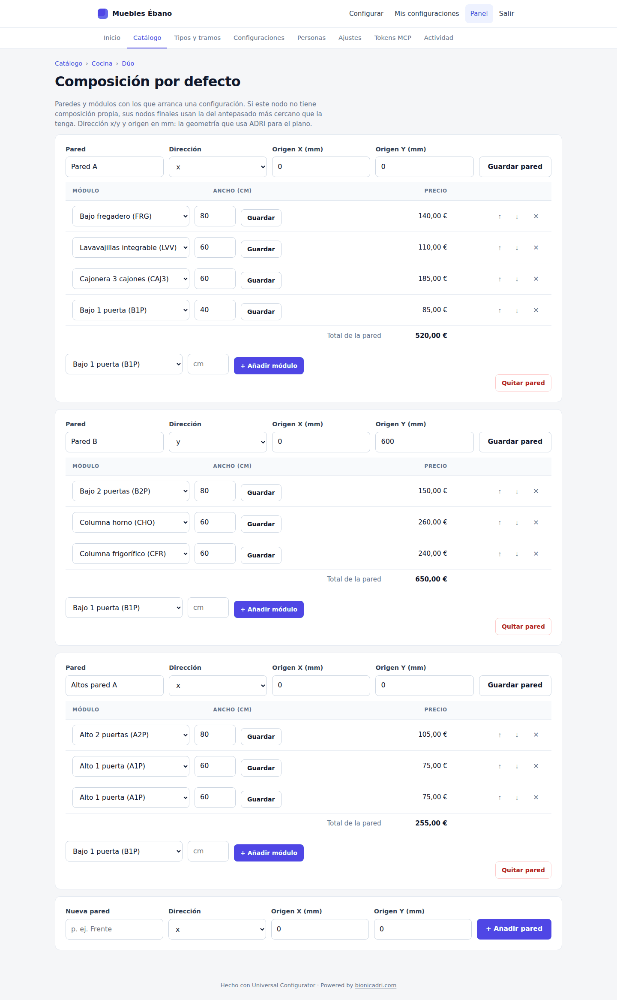

### Configuraciones y descargas

**Panel → Configuraciones.** Todas, con filtros por texto (código, cliente, correo, teléfono), estado (borrador,
presupuesto pedido, aceptada, anulada), estado de trabajo, «solo pendientes de trabajar», fechas y persona.
**Descargar CSV** baja la lista filtrada.

La **ficha** de una configuración tiene los módulos de cada pared con su tramo y precio, el **despiece** de cada
módulo, la **lista de corte** (piezas iguales sumadas, con su módulo de origen) y las descargas **JSON**, **CSV**,
**Despiece CSV** y **Lista de corte CSV**. Desde ahí también se **Duplica**, se **Anula** y, en las pedidas, se
**Acepta**.

**Estado de trabajo**: aparte del estado de venta, cada aceptada lleva su trabajo: **Nuevo** (al aceptarla), **En
curso** o **Hecho**, con una nota de una línea («Planos enviados»). Lo puedes cambiar a mano en la ficha; Adri lo marca
sola cuando la trabaja. «Pendientes» son las aceptadas nuevas o en curso.

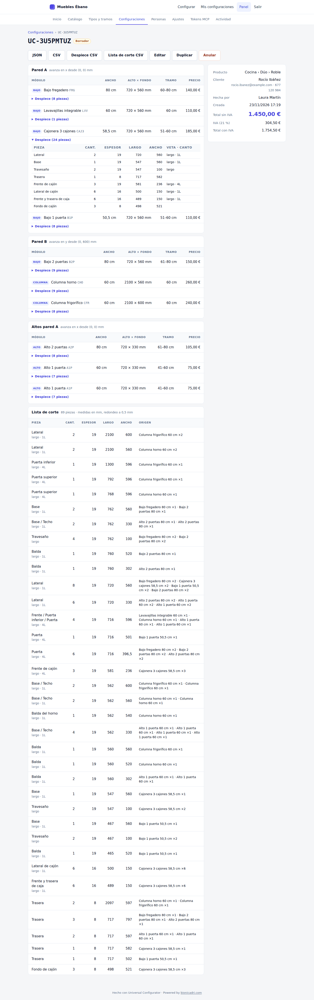

### Leads

**Panel → Leads.** Cada vez que un cliente pulsa «Quiero este presupuesto» entra un lead con su nombre, teléfono,
correo, mensaje y su configuración. Llámale (el teléfono es un enlace) y anota: el **estado** (nuevo, contactado,
cerrado), el **trabajo** (nuevo, en curso, hecho) y una nota. Los nuevos salen primero. En el panel los ves todos; un
token MCP de un comercial solo ve los de sus configuraciones.

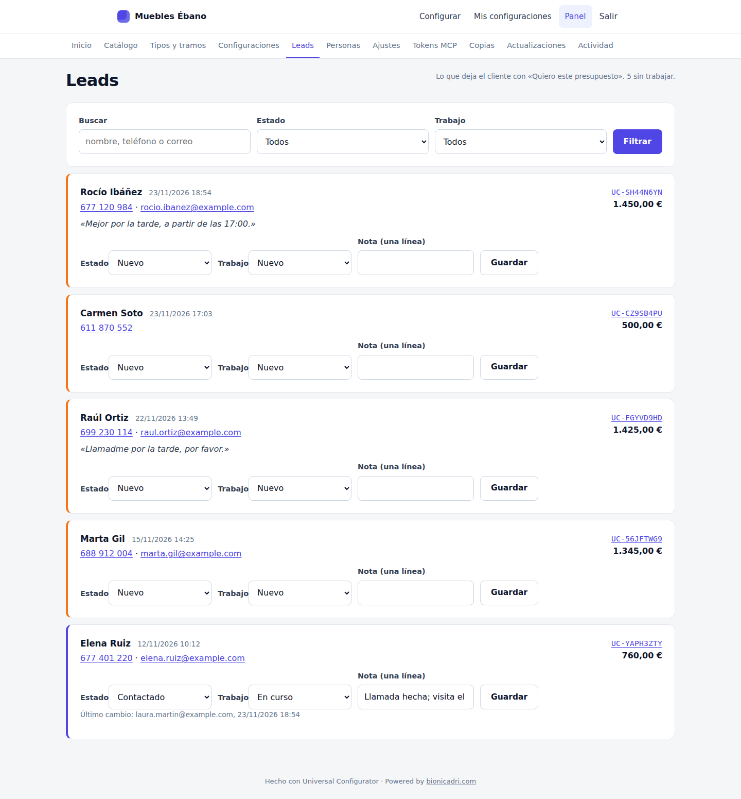

### Personas y roles

**Panel → Personas.** Da de alta a tu equipo con nombre, correo y rol:

| Rol | Qué puede |
|---|---|
| **Administrador** | Todo: panel, catálogo, precios, todas las configuraciones y leads, copias, actualizaciones |
| **Comercial** | Configurar, aceptar, ver y compartir las suyas (no entra en el panel; con un token MCP, Adri le trae sus leads) |
| **Cliente** | Configurar y pedir el presupuesto, ver las suyas |

Al dar de alta le llega un correo con el enlace para poner su contraseña (el panel también lo enseña, por si el correo
no sale). Puedes cambiar el rol, desactivar (cierra sus sesiones y sus tokens dejan de valer) o mandar un enlace nuevo.

### Ajustes y correo

**Panel → Ajustes.** El nombre de la empresa y el logo, la **dirección pública** (la base de todos los enlaces de los
correos; obligatoria), el IVA (solo se muestra aparte), **registro libre de clientes** y **configurar sin cuenta**
(invitado: lo que hace posible la portada con «Empezar»), BionicEye (entrar con la cuenta de BionicEye, opcional) y el
**correo**:
- **mail()** del servidor, **SMTP** (servidor, puerto, cifrado, usuario y contraseña; la contraseña se guarda cifrada)
  o **solo registrar** en `data/mail.log` (para pruebas).
- **Enviarme un correo de prueba**: comprueba que sale antes de dar de alta a nadie.

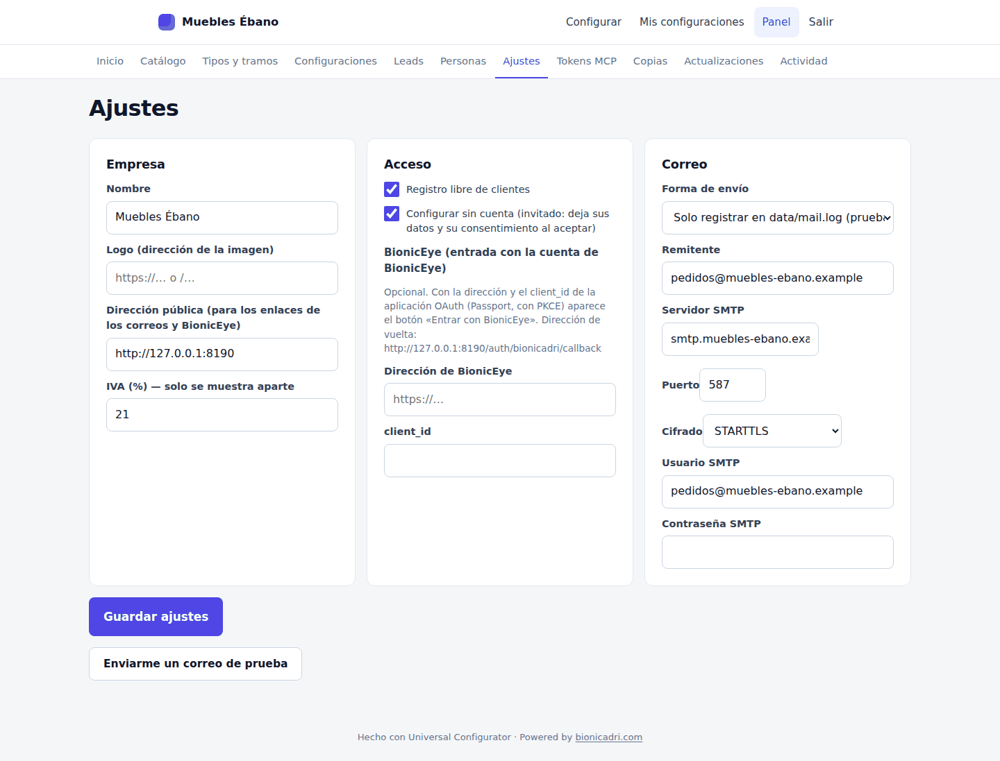

### Tokens MCP y conectar Adri

**Panel → Tokens MCP → Nuevo token.** Un nombre («ADRI»), **como quién actúa** (si es un comercial, solo ve y toca lo
suyo; si es un administrador, todo) y los permisos: **read** (leer catálogo, configuraciones y leads) y **write**
(además crear, cambiar, aceptar, compartir y marcar el trabajo). **El token se ve una sola vez**: cópialo y pégalo en
Adri (servidor `https://tu-dominio/mcp`, cabecera `Authorization: Bearer uc_…`). Se revoca desde la misma pantalla.

En **Inicio**, la tarjeta **«Conecta Adri»** te dice lo que Adri haría hoy con tus datos (tus aceptadas y tus
presupuestos pedidos), con planos de ejemplo, y el botón para crear el token. Cuando Adri usa el token, la tarjeta se
queda en una línea: «Adri conectada · último uso hace N días». La aplicación no envía nada a BionicAdri: solo mira si
el token se ha usado. El manual para la IA está en [`MCP.md`](MCP.md).

| Sin Adri | Con Adri conectada |
|---|---|
| 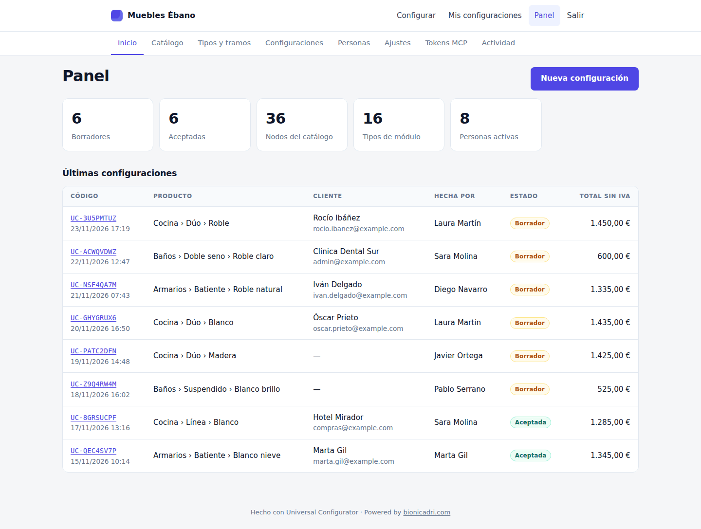 | 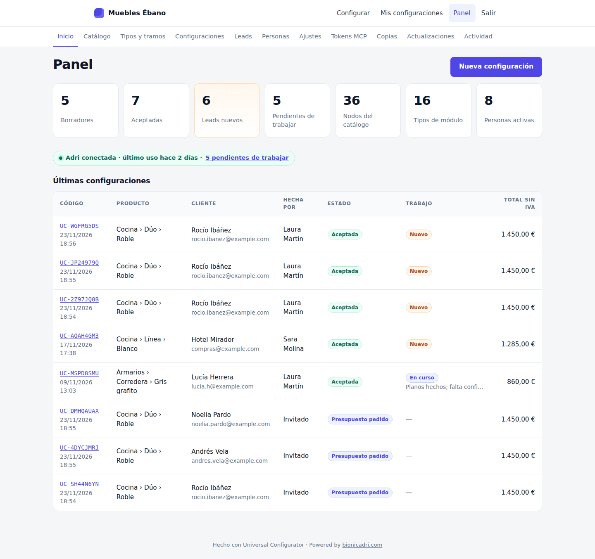 |

### Actividad

**Panel → Actividad.** Todo lo que cambia queda apuntado: quién (persona, token MCP o «copia automática»), cuándo y
qué (configuraciones, catálogo, personas, ajustes, copias, actualizaciones).

### Copias de seguridad

**Panel → Copias de seguridad.**
- **Hacer copia ahora**: un `.zip` con la base de datos (copiada de forma consistente), las imágenes subidas y la
  configuración con la **clave** de la instalación. Por eso **la copia es tan delicada como una contraseña**.
- **Descargar**: puedes escribir una contraseña (10 caracteres o más) y la copia se descarga **cifrada** (`.ucbk`).
  Guarda las copias fuera del servidor.
- **Restaurar**: sustituye todos los datos de ahora por los de la copia. Hay que escribir **RESTAURAR**. Antes, la
  aplicación guarda una copia del estado actual y, durante un momento, enseña «Volvemos en un momento». Se comprueba
  todo antes de tocar nada: que la copia sea de esta aplicación, que no traiga archivos raros, la huella de cada
  archivo y que no sea de una versión más nueva (si lo es, actualiza antes). Por defecto se conserva la clave de esta
  instalación; marca «Restaurar también las claves» solo si la copia viene de otra instalación (si no la marcas, la
  contraseña SMTP de la copia puede no leerse: vuelve a escribirla en Ajustes).
- **Subir una copia**: un `.zip` (o `.ucbk` con su contraseña). Se comprueba entera; con RESTAURAR se restaura al
  momento.
- **Copias automáticas**: una al día o una a la semana, guardando las N más nuevas (7 por defecto). Se hacen tras una
  visita (con PHP-FPM) o con cron del usuario del servidor web: `sudo -u www-data php bin/uc backup --auto`.

Desde el servidor, como el usuario del servidor web (`sudo -u www-data php bin/uc …`, nunca como root): `backup`,
`backups` y `restore <copia.zip> --yes`. Las copias están en `data/backups`. Si prefieres copiar a mano, copia la carpeta `data/` entera **con la aplicación parada** (o
usa `bin/uc backup`, que copia la base de forma segura aunque esté en uso).

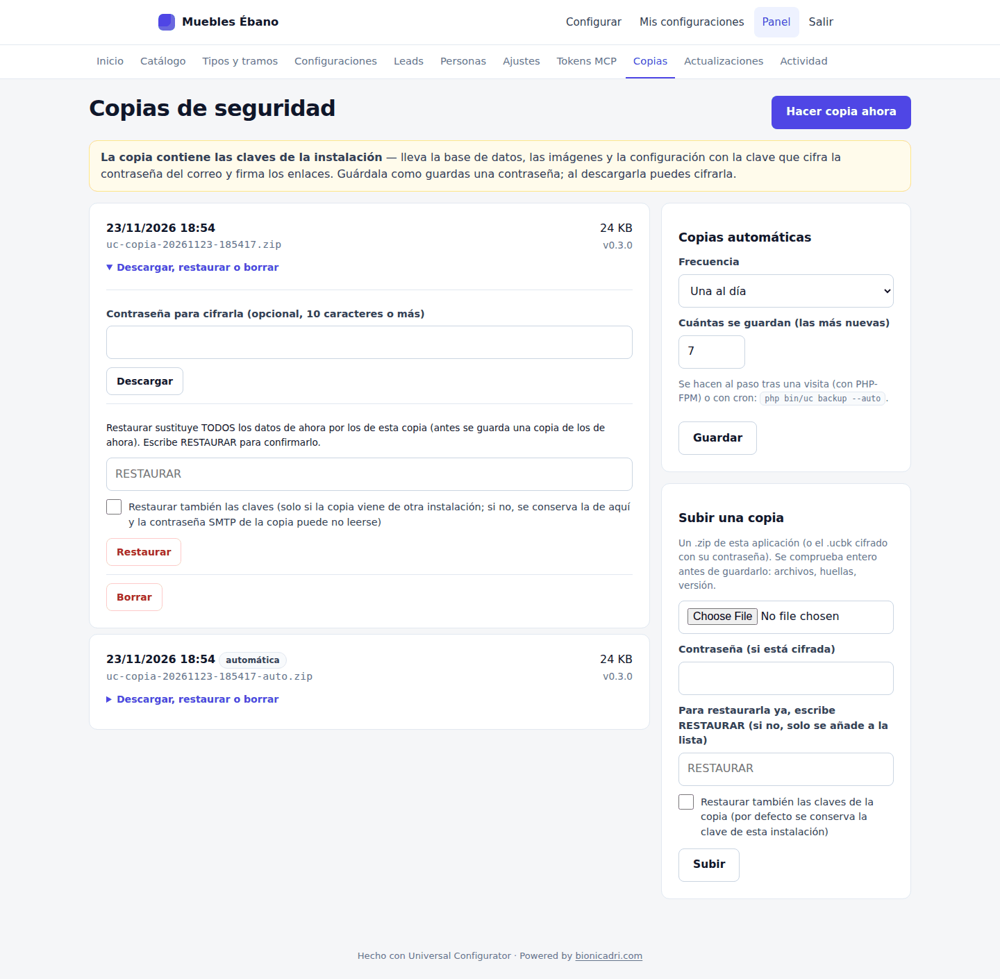

### Actualizaciones

**Panel → Actualizaciones.**
- **Buscar actualizaciones** consulta las versiones publicadas en GitHub. Es **la única conexión que hace la aplicación
  hacia fuera**, y solo cuando la pulsas o si activas «Buscar sola una vez al día». Nunca envía datos tuyos y nunca se
  actualiza sola.
- Si hay versión nueva, ves sus cambios y **Actualizar ahora**: la aplicación hace una copia de seguridad, comprueba que
  el paquete es oficial (firma y huella), pone «Volvemos en un momento», cambia el código (nunca tus datos), pone al día
  la base y comprueba que todo arranca. **Si algo falla, vuelve sola a la versión anterior**, con tus datos tal cual.
- **Volver a la versión anterior**: tras una actualización, puedes deshacerla (solo el código; tus datos se conservan).
- Si el servidor no deja escribir el código (así lo deja el instalador por seguridad), el panel lo dice. Entonces:
  descarga la versión nueva de GitHub con su `.sha256`, compruébala (`sha256sum -c`) y, desde su carpeta, ejecuta
  `sudo ./install.sh`: cambia el código y no toca tus datos. Si la instalación es una copia de Git, actualízala con git.
- Si el código sí es del usuario del servidor web, también se puede desde la terminal:
  `sudo -u www-data php bin/uc update --yes`.
- **Nunca ejecutes `bin/uc` como root** (con `sudo php bin/uc …`): se niega, porque cargaría archivos de `data/` que
  el servidor web puede cambiar. Usa siempre `sudo -u www-data php bin/uc …` (salvo `install`, que si lo lanzas como
  root pasa él solo al dueño de `data/`).

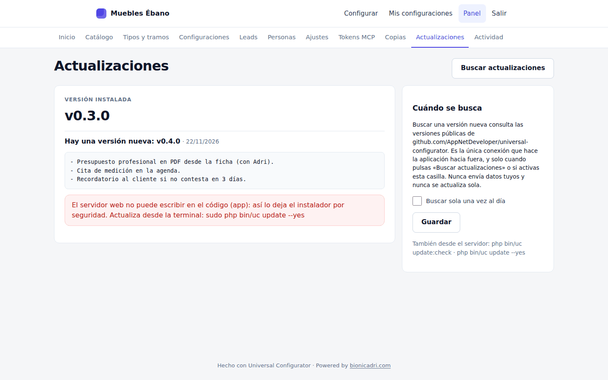

---

## Preguntas frecuentes y problemas típicos

**No llega el correo (altas, contraseña olvidada, «guárdala»).**
1. Mira que la **dirección pública** esté puesta en Ajustes: sin ella no se envía ningún enlace (el panel avisa arriba).
2. Pulsa **Enviarme un correo de prueba**. Si falla, el aviso dice por qué (servidor, puerto, usuario o contraseña
   SMTP).
3. Con `mail()` del servidor, muchos correos acaban en spam: usa SMTP con una cuenta de tu dominio.
4. Para comprobar sin enviar, «solo registrar» deja cada correo en `data/mail.log`.
5. Mientras, el panel enseña el enlace de alta de cada persona en **Personas** para que se lo pases tú.

**Sale «Actualizando la aplicación» o «Volvemos en un momento».**
- «Actualizando la aplicación: reintenta en unos segundos» aparece un instante después de instalar una versión nueva
  (se está poniendo al día la base). Recarga en unos segundos.
- «Volvemos en un momento» es el modo mantenimiento durante una restauración o una actualización; dura uno o dos
  minutos. Si un proceso se cortara a mitad, el aviso caduca solo; si era una actualización, la siguiente visita la
  termina o la deshace, y desde el servidor `sudo -u www-data php bin/uc update:finish` hace lo mismo.

**«No es una medida válida».** La medida no cae en ningún tramo del módulo (o está fuera de su mínimo o máximo). El
aviso dice qué tramos hay: toca uno de los botones de tramos o escribe una medida dentro. Una medida **entre** dos
tramos sí vale: se cobra como el de arriba.

**«Este token no tiene el permiso 'write'».** El token de Adri se creó solo con **read**: crea otro con **write** en
Tokens MCP (y revoca el viejo). Si dice «Aceptar es del comercial o del administrador», el token actúa como un
cliente: créalo a nombre de un comercial o del administrador. Si no ve una configuración («No existe… o no tienes
acceso»), el token es de un comercial y la configuración es de otro.

**El cliente no ve «Empezar».** Activa **Configurar sin cuenta** en Ajustes. Sin eso, la portada es el formulario de
entrar.

**Una configuración pedida no sale en «pendientes».** Lo que pide el cliente se trabaja en su **lead** (Panel →
Leads). «Pendientes» son las **aceptadas** con el trabajo nuevo o en curso.

**He restaurado una copia de otra instalación y el correo no sale.** Sin «Restaurar también las claves», la contraseña
SMTP de la copia no se puede leer: vuelve a escribirla en Ajustes.
